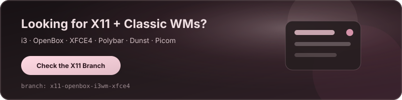
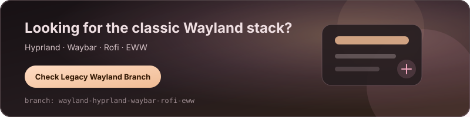
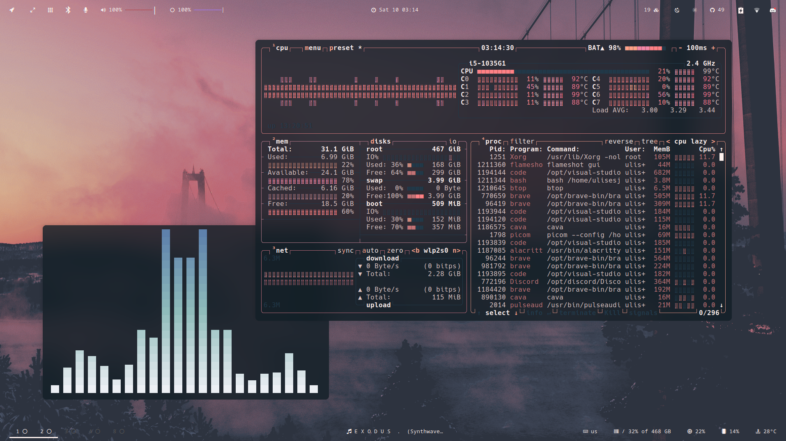
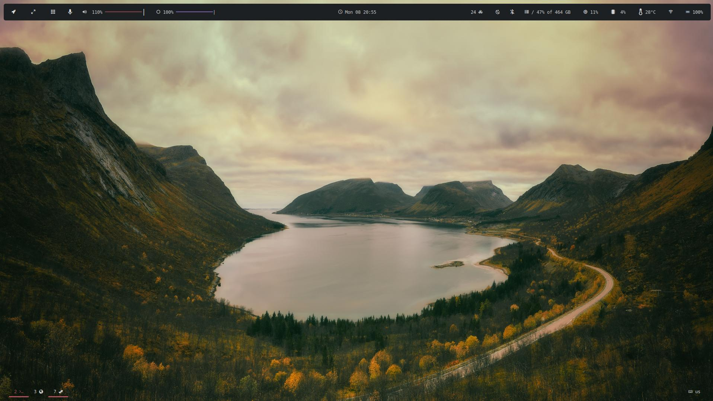
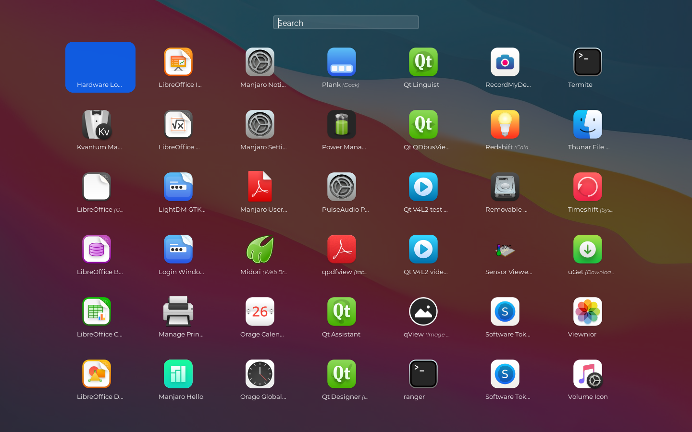
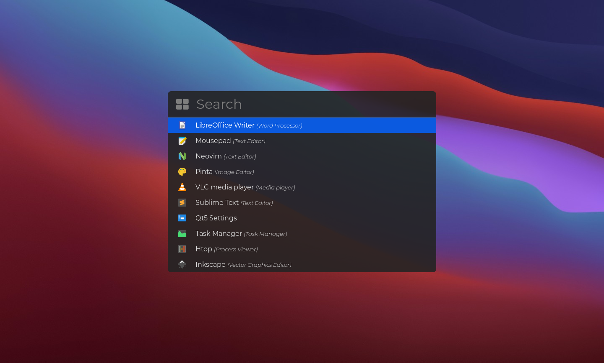

<p align="center">
  
</p>

<div align="center">

```ocaml
🚀 NEVER SKIP THE README - YOUR JOURNEY STARTS HERE! 🚀
```

<h1>🏠 HorneroConfig</h1>
<h3>✨ The Ultimate Linux Desktop Configuration Framework ✨</h3>

<p><strong>Intelligent • Beautiful • Powerful • Seamless</strong></p>

[📖 Documentation](https://github.com/ulises-jeremias/dotfiles/wiki) •
[🎨 Gallery](#-gallery) •
[🚀 Quick Start](#-quick-installation) •
[🤝 Contributing](CONTRIBUTING.md)

<p>
  <a href="https://github.com/PandaFoss/Awesome-Arch">
    
  </a>
  <a href="https://aur.archlinux.org/packages/hornero-config">
    
  </a>
  <a href="https://aur.archlinux.org/packages/hornero-shell">
    
  </a>
  <a href="LICENSE">
    
  </a>
  <a href="https://archlinux.org/">
    
  </a>
  <a href="https://discord.gg/bR5VyATgka">
    
  </a>
  <a href="https://github.com/ulises-jeremias/dotfiles/actions/workflows/clone-and-install.yml">
    
  </a>
</p>

<p><strong>Looking for the product?</strong> This is the maintainer's personal
chezmoi source — the historical origin of the project. The Hornero desktop
itself now lives in the <a href="https://github.com/HorneroOS">HorneroOS
organization</a>: <a href="https://www.horneroos.com">horneroos.com</a> •
<a href="https://github.com/HorneroOS/config">config</a> •
<a href="https://github.com/HorneroOS/shell">shell</a></p>

<div align="center">
  <a href="https://github.com/ulises-jeremias/dotfiles/tree/x11-openbox-i3wm-xfce4">
    
  </a>
</div>

<div align="center">
  <a href="https://github.com/ulises-jeremias/dotfiles/tree/wayland-hyprland-waybar-rofi-eww">
    
  </a>
</div>

</div>

---

## 🌟 What is HorneroConfig?


**HorneroConfig** is a cutting-edge dotfiles framework that transforms your Linux desktop into a masterpiece of functionality and beauty. Named after the industrious hornero bird 🐦, renowned for its skillful nest-building, this framework empowers you to craft the perfect digital workspace.

### ✨ Highlights

🧠 **Smart Color Intelligence** — Automatic theme-aware color adaptation  
🎨 **Hornero Signal** — Retrofuturist, cozy look with night, day and high-contrast themes, plus palettes generated from your wallpaper (Chromatic)  
⚡ **One-Command Setup** — From zero to hero in minutes  
🌊 **Hyprland/Wayland** — Modern compositor with smooth animations  
🔧 **100+ Automation Scripts** — Comprehensive tooling ecosystem  
🛡️ **Security-First** — Built-in auditing and hardening  
📦 **Zero Maintenance** — Powered by chezmoi for seamless updates

<br clear="right"/>

---

## 🎨 Gallery

> **Legacy captures (X11 era, personal machine).** The screenshots below are
> kept as history: they show the pre-HorneroOS Xorg/picom desktop, including
> that machine's own user and hardware values. For the current desktop, see
> [horneroos.com](https://www.horneroos.com).

<details>
<summary>🖼️ <b>Click to view screenshots</b></summary>

<div align="center">

### 🌙 Dark Theme



### ☀️ Light Theme



### 🚀 Application Launchers

 

</div>

</details>

---

## 🚀 Quick Installation

### ⚡ Quick Install (Recommended)

```bash
git clone https://github.com/ulises-jeremias/dotfiles ~/.dotfiles
~/.dotfiles/install.sh
```

`install.sh` installs chezmoi if needed and runs
`chezmoi init --apply --source ~/.dotfiles`.

#### 🔄 Updating an existing install

```bash
cd ~/.dotfiles && git pull
~/.dotfiles/install.sh
```

This fast-forwards the checkout to the latest `main` and re-applies it.
Your local files outside the chezmoi source are not touched by the pull;
chezmoi shows and applies only the managed differences.

### 📦 Arch Linux (AUR)

```bash
yay -S hornero-shell hornero-config hornero-greeter   # HorneroOS product packages
```

> 💡 **Performance Tip**: HorneroConfig automatically configures [Chaotic-AUR](https://aur.chaotic.cx/) during installation, providing precompiled binaries for popular AUR packages in the Hyprland + Quickshell ecosystem to significantly reduce installation time.

<details>
<summary>🛠 <b>More installation methods</b></summary>

#### Using Chezmoi

```bash
chezmoi init --apply ulises-jeremias --source ~/.dotfiles
```

#### From Source

```bash
git clone https://github.com/ulises-jeremias/dotfiles ~/.dotfiles
~/.dotfiles/install.sh
```

#### Manual AUR Build

```bash
git clone https://aur.archlinux.org/hornero-shell.git /tmp/hornero-shell
cd /tmp/hornero-shell && makepkg -si
```

</details>

---

## 💎 Key Features

### 🧠 Smart Colors and Hornero Chromatic

Colour is owned by HorneroOS, not by this repository. Hornero Signal themes carry a fixed set of semantic roles, and Hornero Chromatic can generate a gated palette from your wallpaper or a seed colour:

✨ **Semantic Intelligence** — Error, success, warning, info colors that make sense  
🎨 **Theme Adaptation** — Perfect contrast and readability on any background  
⚡ **Auto-Application** — Applies to the Shell, Hyprland, GTK, Qt and terminals through `horneroctl appearance`  
🔄 **Live Updates** — Colors refresh automatically when you change wallpapers

> 📖 [Learn more about Smart Colors →](https://github.com/ulises-jeremias/dotfiles/wiki/Smart-Colors-System)

### 🎨 Appearance Themes & Themes

Hornero Signal ships `hornero-signal-night`, `hornero-signal-day` and
`hornero-signal-contrast` next to the curated theme packs. Run
`horneroctl appearance theme list` for the full, current list:

```bash
horneroctl appearance theme list                     # See all available themes
horneroctl appearance theme set hornero-signal-night # Apply one
horneroctl appearance chromatic preview --seed "#D98A3A"
horneroctl mode set everyday                         # focus|everyday|signal|gaming|studio
```

See [Hornero Signal on this workstation](docs/Hornero-Signal.md) for what the
installed releases provide and how personal preferences are layered on top.

> 📖 [Explore all themes →](https://github.com/ulises-jeremias/dotfiles/wiki/Rice-System-Theme-Management)

### 🔧 Core Stack

🌊 **[Hyprland](https://hyprland.org)** — Dynamic tiling Wayland compositor  
🐚 **[Quickshell](https://quickshell.org)** — Unified QML desktop shell (bar, launcher, dashboard, notifications, AI chat)  
🐾 **Terminal** — Selected through Hornero (Ghostty is seeded; see `horneroctl apps terminal-file`)  
🐚 **[Zsh](https://zsh.org) + [Powerlevel10k](https://github.com/romkatv/powerlevel10k)** — Feature-rich shell with beautiful prompt  
🔒 **[Hyprlock](https://github.com/hyprwm/hyprlock)** — Secure lock screen  
🖼️ **Quickshell wallpaper flow** — Unified wallpaper management via `horneroctl wallpaper set`  
🎨 **Appearance Themes** — Instant theme switching with Hornero Signal schemes

> 📖 [Complete component list →](https://github.com/ulises-jeremias/dotfiles/wiki/Home)

### 🛠️ Powerful Automation

Everything desktop-level goes through `horneroctl`:

```bash
horneroctl package upgrade --yes  # Comprehensive system updates
horneroctl appearance colors      # Intelligent color analysis
horneroctl apps audit             # Security analysis and hardening
horneroctl appearance theme       # Appearance themes
```

📂 `horneroctl config` — Inspect and snapshot configuration  
🔄 `horneroctl package upgrade` — Sync with upstream changes

> 📖 [Scripts documentation →](https://github.com/ulises-jeremias/dotfiles/wiki/Dots-Scripts)

---

## 🧪 Development & Testing

### 🎮 Safe Testing Environment

Try HorneroConfig risk-free with our Vagrant playground:

```bash
git clone https://github.com/ulises-jeremias/dotfiles && cd dotfiles
./bin/play                        # Start VM
./bin/play --provision hyprland   # Provision with Hyprland
./bin/play --remove               # Clean up
```

> 📖 [Testing guide →](docs/Testing-Strategy.md)

### 🔧 Contributing

We use [pre-commit](https://pre-commit.com/) for code quality:

Install `uv` first:

- **Arch Linux:** `sudo pacman -S uv`
- **Other platforms:**
  - Installation script: `curl -LsSf https://astral.sh/uv/install.sh | sh`
  - Homebrew: `brew install uv`

```bash
uv tool install pre-commit  # Install pre-commit
# One-shot alternative: uvx pre-commit run --all-files

pre-commit install          # Set up hooks
pre-commit run --all-files  # Run all checks
```

> 🤝 [Contributing guide →](CONTRIBUTING.md) | [Development standards →](docs/Development-Standards.md)

---

## 📖 Documentation

### 📚 For Users

🏠 [**Getting Started**](https://github.com/ulises-jeremias/dotfiles/wiki/Home) — First steps and basic setup  
🎨 [**Appearance Themes**](https://github.com/ulises-jeremias/dotfiles/wiki/Rice-System-Theme-Management) — Theme management  
🧠 [**Hornero Signal**](docs/Hornero-Signal.md) — Themes, Chromatic, experience modes and personal overrides  
🐚 [**Quickshell**](https://github.com/ulises-jeremias/dotfiles/wiki/Quickshell-Shell) — Desktop shell configuration  
🔧 [**Scripts**](https://github.com/ulises-jeremias/dotfiles/wiki/Dots-Scripts) — Automation tools  
🛡️ [**Security**](https://github.com/ulises-jeremias/dotfiles/wiki/Security) — Privacy and security

### 🤖 For Developers & AI Agents

📋 [**AGENTS.md**](AGENTS.md) — Quick reference guide  
🏗️ [**Architecture**](docs/Architecture-Philosophy.md) — Design principles  
📐 [**ADRs**](docs/adrs/) — Architecture decisions  
🔒 [**Security**](docs/Security-Guidelines.md) — Security practices  
⚡ [**Performance**](docs/Performance-Guidelines.md) — Optimization strategies

---

## 🌍 Platform Support

🐧 **Arch Linux** — Full support with AUR packages (primary target)  
🐧 **Ubuntu/Debian** — Partial: the Docker install fragment supports Ubuntu/Pop!\_OS; everything else is Arch-only (manual porting required)  
☁️ **Cloud Dev** — GitHub Codespaces, Gitpod, VS Code Remote

> 📖 [Platform-specific guides →](https://github.com/ulises-jeremias/dotfiles/wiki/Home)

---

## 🤝 Contributing

We welcome all contributions! 🎉

🐛 Bug reports • ✨ Feature requests • 🎨 New themes • 📚 Documentation • 🔧 Code

<div align="center">

### 🌟 Contributors

<a href="https://github.com/ulises-jeremias/dotfiles/contributors">
  
</a>

</div>

---

## 🙏 Credits & Attribution

### Quickshell Desktop Shell

The **Quickshell** implementation in HorneroConfig was highly inspired by and adapted from the amazing work of the [**caelestia-dots/shell**](https://github.com/caelestia-dots/shell) project by [@soramanew](https://github.com/soramanew).

- **Original Project**: [caelestia-dots/shell](https://github.com/caelestia-dots/shell)
- **License**: GNU General Public License v3.0 (GPL-3.0)
- **What we adapted**: UI/UX design, desktop shell architecture, C++ plugin structure

The Shell implementation, and the attribution and GPL-3.0 licence that go with it, live in [HorneroOS/shell](https://github.com/HorneroOS/shell); this repository no longer carries a copy. We are deeply grateful for the beautiful and functional desktop shell that inspired it.

---

<div align="center">

### 💝 Show Your Support

If HorneroConfig has improved your Linux experience:

⭐ **[Star this repo](https://github.com/ulises-jeremias/dotfiles)** • 🐦 **Share it** • 🤝 **Contribute**

<br>

**🏠 HorneroConfig**  
*Building the perfect digital nest, one configuration at a time*

<sub>[horneroos.com](https://www.horneroos.com) • [HorneroOS/config](https://github.com/HorneroOS/config) • [HorneroOS/shell](https://github.com/HorneroOS/shell) • [Issues](https://github.com/ulises-jeremias/dotfiles/issues) • Licensed under [MIT License](LICENSE) • Made with ❤️ for the Linux community</sub>

</div>
